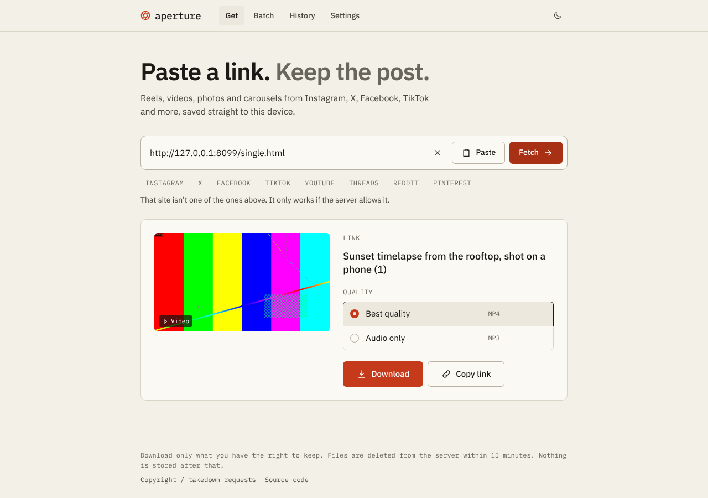
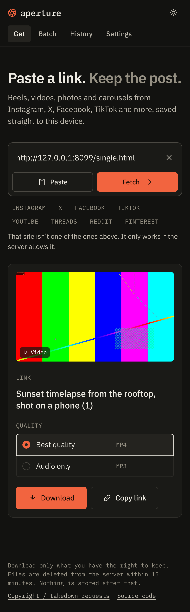

# Aperture

**Live: https://aperture.advaitachandra.in**

**Save reels, videos, photos and carousels from Instagram, X, Facebook and Pinterest.** Paste a link, pick a quality, get the file. It's a web app that works in Brave, Chrome and on phones, and you can install it to your home screen and share posts straight to it.

When you run it on your own PC you can also enable TikTok, YouTube, Reddit and Threads (`ENABLED_PLATFORMS`). They're off on the public instance because those platforms block cloud servers.

<p>
  
  
</p>

## Features

- **Paste anywhere**: <kbd>Ctrl</kbd>+<kbd>V</kbd> anywhere on the page; pasted chat messages work too ("look at this https://… 🔥").
- **Quality picker**: Best / 1080p / 720p / 480p / audio only (MP3 or M4A), with size estimates.
- **Carousels**: every photo and video in a post; download one or all.
- **Batch**: paste a list of links and queue them all.
- **Installable app**: in Brave, use *Install app*; in mobile Chrome, *Add to Home screen*. On Android it then appears in the share sheet.
- **Live progress**, light/dark themes, keyboard friendly, screen-reader tested.
- **Nothing kept**: files are deleted from the server minutes after download. There are no accounts and no database.

## How reliable is it?

Downloaders depend on the platforms, which actively change their sites to stop them. **No downloader works 100% of the time**, including the big commercial ones. Aperture is built to fail rarely and recover quickly:

| | |
|---|---|
| Two extractors | [yt-dlp](https://github.com/yt-dlp/yt-dlp) for video and [gallery-dl](https://github.com/mikf/gallery-dl) for photos and mixed carousels, with automatic fallback between them |
| Auto-update | `AUTO_UPDATE=1` upgrades both on start and daily. Most breakages are fixed upstream within days. |
| Automatic retry | A failed download is retried once with a simpler format |
| Network retries | Retries for flaky connections and known platform errors |
| YouTube | Ships with the JavaScript runtime support YouTube now requires |
| Clear errors | Every failure says what happened and what to try |

**Where it runs matters.** Platforms block cloud-server IPs far more than home connections:

- **Public instance (e.g. Render free):** most X, TikTok, Facebook and Reddit links work. YouTube and especially Instagram often hit "login required" or bot checks from cloud IPs.
- **Your own PC:** the best success rate, plus your own login cookies for Instagram and private posts.

## Make Instagram work reliably (no personal login)

Aperture fetches Instagram posts itself first, which is free and works for most public posts. If that fails, it asks a **backup**: Apify's official [Instagram scraper](https://apify.com/apify/instagram-scraper), which runs on Apify's own infrastructure. No Instagram account of yours is involved.

1. Sign up free at [apify.com](https://apify.com). The free plan includes $5 of usage credit every month.
2. Copy your API token from **Apify Console → Settings → API & Integrations**.
3. In Render: **aperture → Environment → Add Environment Variable**. Set `APIFY_TOKEN` to the token, then save. Render redeploys, and the logs show `✓ Instagram backup via Apify`.

Each backup lookup costs about $0.0027. `APIFY_DAILY_LIMIT` (default 60/day, about $4.90/month) keeps usage inside the free credit; when it's reached, Instagram falls back to the free path only until the next day. Media is downloaded straight from Instagram's CDN, and only `*.cdninstagram.com` / `*.fbcdn.net` URLs are accepted.

Private accounts, stories and deleted posts can't be downloaded either way.

**Running it only for yourself?** You can instead give Aperture your own login with `COOKIES_FILE` (see below). Don't do that on a public instance: everyone's downloads would run through your account.

## Deploy free on Render (public instance)

1. Push this repo to GitHub.
2. In [Render](https://render.com): **New → Blueprint**, pick the repo. `render.yaml` sets up a free Docker web service with `PUBLIC_MODE=1` and `AUTO_UPDATE=1`.
3. `CONTACT_URL` (takedown requests → this repo's Issues) and `REPO_URL` are already set in `render.yaml`. Change them there if you fork.

Render's free tier ([docs](https://render.com/docs/free)) sleeps after 15 minutes without traffic. Aperture prevents that by visiting its own public URL every 10 minutes (Render sets `RENDER_EXTERNAL_URL` automatically; `KEEP_AWAKE=0` turns it off). Render gives 750 free instance hours a month and a month has at most 744, so **one** always-on service fits. A second free service in the same workspace would run both out of hours. The disk is temporary, which suits Aperture: files are only kept for minutes anyway.

Public mode turns on stricter limits: 500 MB per file, 90-minute videos, 3 downloads at a time per visitor, rate-limited requests, and cookies are always ignored, so the server never acts as anyone's account. The `Dockerfile` also runs on any other Docker host.

## Run it on your own PC

Requirements: **Node 20.12+**, **Python 3.9+**, **ffmpeg**.

### Windows: easiest way

1. Install the prerequisites in PowerShell, one line at a time, then close and reopen PowerShell:
   ```powershell
   winget install OpenJS.NodeJS.LTS
   ```
   ```powershell
   winget install Python.Python.3.12
   ```
   ```powershell
   winget install Gyan.FFmpeg
   ```
2. Double-click **`Start Aperture.bat`**. It installs the rest, builds the app and opens http://127.0.0.1:8787. Keep its window open while you use Aperture.

### macOS / Linux / manual

```bash
python3 -m pip install -U "yt-dlp[default]" gallery-dl
```
```bash
npm run setup
```
```bash
npm run dev
```

Open http://127.0.0.1:5173. For a single-process production build, use `npm start` (http://127.0.0.1:8787).

### Instagram and private posts (own PC only)

1. In a browser where you're logged in, export cookies with a "cookies.txt" extension (e.g. *Get cookies.txt LOCALLY*).
2. Copy `.env.example` to `.env` and set `COOKIES_FILE=` to that file's full path.
3. Restart.

Treat that file like a password. Never put it on a public instance; public mode ignores it anyway.

### Use it from your phone

Set `HOST=0.0.0.0` and `APP_PASSCODE=…` in `.env`, then open `http://<your-PC's-IP>:8787` on your phone (same Wi-Fi). To reach your PC from anywhere, put it behind a free tunnel such as [Cloudflare Tunnel](https://developers.cloudflare.com/cloudflare-one/connections/connect-networks/) or [Tailscale](https://tailscale.com).

## Configuration

All settings are environment variables. See [`.env.example`](.env.example) for the full list with explanations.

## Security

- **Host allowlist.** Extractors only run on listed platforms. Lookalike domains, local addresses, `file:` and credentialed URLs are rejected.
- **No shell.** Extractors run via `execFile` with argument arrays, and the client can only pick a pre-validated quality id.
- **No open proxy.** Downloads and thumbnails reference server-side ids, so the server never fetches a URL a visitor supplies directly.
- **Abuse limits.** Helmet headers with CSP, rate limits, a per-visitor job cap, size and duration caps, process timeouts, and errors that don't expose internals.
- **Optional passcode gate.** HttpOnly SameSite=Strict cookie, constant-time compare, login rate limit.

## Development

```bash
npm test
```

```
server/src/index.js      routes, limits, passcode gate, static hosting
server/src/platforms.js  host allowlist + link extraction (unit-tested)
server/src/extract.js    yt-dlp / gallery-dl probing and error mapping
server/src/jobs.js       download queue, retry, progress, cleanup
server/src/tools.js      finds the extractors (PATH or Python module)
server/src/updater.js    daily extractor auto-update
web/src/                 React app (Vite + TypeScript)
web/public/sw.js         service worker (installable PWA)
```

## Responsible use

Aperture is for saving content you have the right to keep: your own posts, content you have permission to save, or personal offline viewing where your local law allows it. Downloading may break a platform's terms of service, and re-uploading others' work can infringe copyright. If you run a public instance, you're its operator: provide a takedown contact (`CONTACT_URL`) and respond to requests.

Logo blade geometry adapted from [Feather Icons](https://feathericons.com) (MIT).
