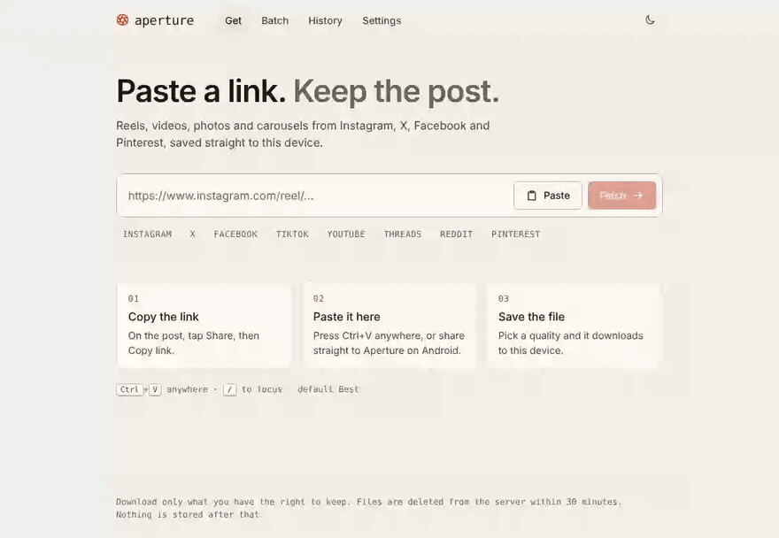
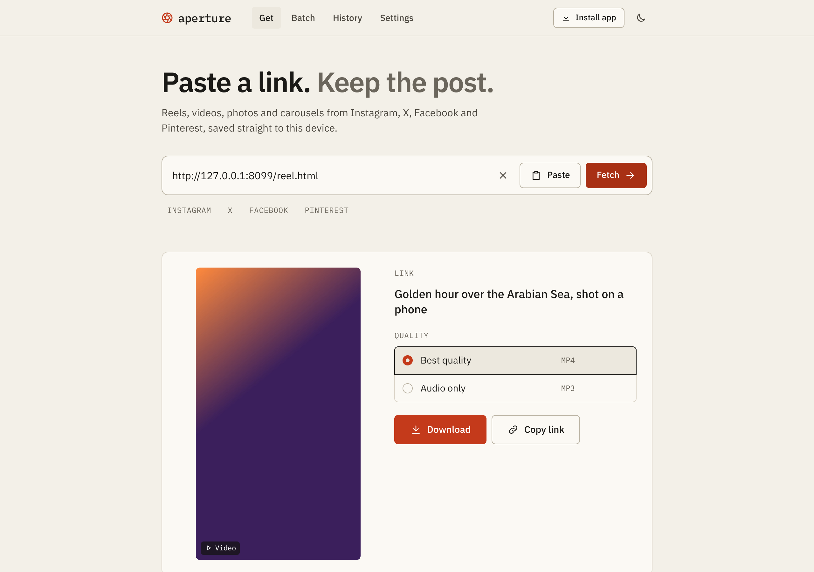
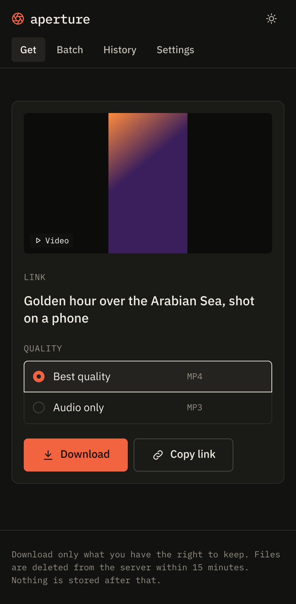
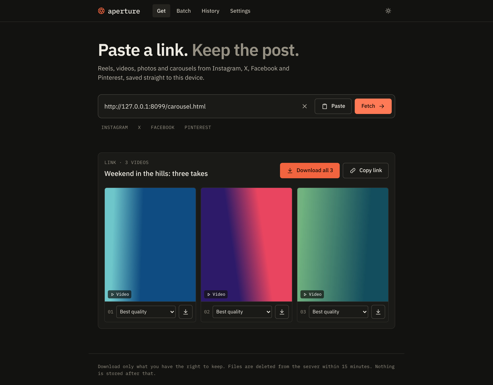
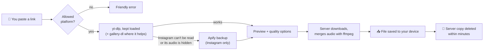

<div align="center">


# Aperture

**Paste a link. Keep the post.**

Save reels, videos, photos and full carousels from **Instagram, X, Facebook and Pinterest**,
straight to your phone or computer. No ads, no accounts, no tracking.

<a href="https://aperture.advaitachandra.in"><strong>✨ Open the app →</strong></a>

<br><br>

[](https://aperture.advaitachandra.in)
[](https://github.com/w1tneess/aperture/actions/workflows/ci.yml)
[](LICENSE)


<br>



<sub>Paste → preview → download. Real app, real progress bar.</sub>

</div>

---

<p align="center">
  <a href="#why-aperture">Why</a> ·
  <a href="#-install-it-as-an-app">Install</a> ·
  <a href="#how-it-works">How it works</a> ·
  <a href="#reliability-honestly">Reliability</a> ·
  <a href="#-run-it-yourself">Self-host</a> ·
  <a href="#-security">Security</a> ·
  <a href="#-faq">FAQ</a>
</p>

## Why Aperture

Most "downloader" sites are ad farms with fake buttons. Aperture is the opposite: one clean page that does the job and gets out of the way.

<table>
<tr>
<td width="50%" valign="top">

### ⚡ Fast by design
- **Answers in seconds:** most links show their preview in 2–4 s, even on the free public server ([measured](#why-its-fast)).
- **Paste anywhere:** <kbd>Ctrl</kbd>+<kbd>V</kbd> on the page, no clicking the box first. <kbd>/</kbd> focuses it.
- **Messy text works:** paste a whole chat message ("lol look at this https://… 🔥") and it finds the link.
- **Quick mode:** skip the preview and download instantly at your default quality.
- **Batch:** paste a list of links and queue them all at once.

</td>
<td width="50%" valign="top">

### 🎛️ You choose the output
- **Quality picker:** Best, 1080p, 720p, 480p, with size estimates.
- **Audio only:** MP3 or M4A.
- **Carousels:** every photo and video in a post, one at a time or all at once.
- **Live progress:** real progress bars, speed and time left.

</td>
</tr>
<tr>
<td width="50%" valign="top">

### 📱 Feels like an app
- **Installable:** *Install app* in Brave/Chrome, *Add to Home screen* on Android.
- **Share target:** on Android, share a post from Instagram or X straight to Aperture.
- **Light and dark** themes, keyboard-friendly, screen-reader tested (zero axe violations).

</td>
<td width="50%" valign="top">

### 🔒 Private by default
- **No accounts, no database, no analytics.**
- **Files are deleted from the server within minutes** of being created.
- **History stays on your device** (browser storage), and you can turn it off.

</td>
</tr>
</table>

<div align="center">

&nbsp;

<br><br>

</div>

## 📲 Install it as an app

Aperture is a Progressive Web App: install it once and it opens like a native app, in its own window, with its own icon.

| Where | How |
|---|---|
| **Brave / Chrome on desktop** | Click **Install app** in Aperture's top bar (or the install icon in the address bar) |
| **Chrome / Brave on Android** | Menu **⋮ → Add to Home screen** (or **Install app**). Aperture then shows up in the **Share** sheet: share a post from Instagram or X straight to it |
| **Safari on iPhone** | **Share → Add to Home Screen** |

## How it works



- **[yt-dlp](https://github.com/yt-dlp/yt-dlp)** handles video, quality selection and audio extraction. On Instagram it also reads photo posts and carousels without logging in, from the same public data Instagram shows any visitor.
- **[gallery-dl](https://github.com/mikf/gallery-dl)** handles photos and mixed carousels on X, Facebook and Pinterest. It's skipped for Instagram unless login cookies are configured, because Instagram blocks it when logged out.
- **[Apify](https://apify.com/apify/instagram-scraper)** is an optional backup for Instagram posts the free path can't read, or videos whose sound Instagram hides from logged-out visitors. It's rarely needed now. No personal Instagram account is ever used.

### Why it's fast

- **Extractors stay loaded.** One long-running Python worker keeps yt-dlp and gallery-dl in memory, so a lookup doesn't pay ~1 CPU-second of startup first. On a small server (Render's free tier has a fraction of a CPU) that alone was about 8 seconds per link. If the worker can't start, Aperture falls back to running the tools directly.
- **No waiting on tools that can't succeed.** Reel links skip photo extraction, and genuinely silent videos are kept instead of being sent to the backup.
- **Repeat links are instant.** Results are reused for 10 minutes, and identical lookups running at the same time share one.
- **One request to the backup** instead of starting a job and polling it.

Measured on the public instance (free Render server):

| Link | Before | Now |
|---|---|---|
| X post | 9.8 s | 1.7–3.9 s |
| Instagram video | ~11 s | 2.7 s |
| Instagram photo or carousel | 15–60 s (via backup) | 3.3 s |
| Instagram silent video | 48–70 s (via backup) | ~2 s (measured locally) |

## Reliability, honestly

Platforms actively fight downloaders, so **no downloader works 100% of the time**. Aperture is built to fail rarely and recover on its own:

| Problem | What Aperture does |
|---|---|
| A platform changes its site | Extractors update **daily** (yt-dlp nightly builds), usually fixed within days |
| Instagram blocks logged-out requests | Reads the public post data directly; falls back to the **Apify backup** only if that fails |
| A download glitches | **Retries automatically** with a simpler format |
| Free hosting goes to sleep | Pings itself every 10 min: **no cold starts** (measured: 684 ms after 26 min idle) |
| Something still fails | Says **what happened and what to try**, never a bare "error" |

The public instance supports Instagram, X, Facebook and Pinterest. TikTok, YouTube and Reddit block cloud servers, but they work if you [self-host at home](#-run-it-yourself) and set `ENABLED_PLATFORMS`.

## 🚀 Run it yourself

### One click on Render (free)

[](https://render.com/deploy?repo=https://github.com/w1tneess/aperture)

The [`render.yaml`](render.yaml) blueprint sets up a free Docker service with public-mode limits, daily auto-updates and keep-awake. For the Instagram backup, add an `APIFY_TOKEN` environment variable ([free Apify account](https://apify.com), $5 of credit every month; Aperture caps usage at 60 lookups a day to stay inside it).

### On your computer

You need **Node 20.12+**, **Python 3.9+** and **ffmpeg**.

<details>
<summary><b>🪟 Windows</b></summary>

Install the prerequisites in PowerShell, one line at a time, then reopen PowerShell:

```powershell
winget install OpenJS.NodeJS.LTS
```
```powershell
winget install Python.Python.3.12
```
```powershell
winget install Gyan.FFmpeg
```

Then double-click **`Start Aperture.bat`**. It installs everything else, builds the app and opens http://127.0.0.1:8787.

</details>

<details>
<summary><b>🍎 macOS / 🐧 Linux</b></summary>

```bash
python3 -m pip install -U --pre "yt-dlp[default]" gallery-dl
```
```bash
npm run setup
```
```bash
npm run dev
```

Open http://127.0.0.1:5173, or run `npm start` for a single-process production build on http://127.0.0.1:8787.

</details>

<details>
<summary><b>🐳 Docker</b></summary>

```bash
docker build -t aperture .
```
```bash
docker run -p 8787:8787 -e PUBLIC_MODE=1 aperture
```

</details>

### Configuration

Everything is set with environment variables. The full, commented list is in [`.env.example`](.env.example). The most useful ones:

| Variable | What it does |
|---|---|
| `PUBLIC_MODE=1` | Stricter limits for a shared instance (500 MB files, 90-minute videos, 3 jobs per visitor) |
| `APIFY_TOKEN` | Enables the Instagram backup |
| `ENABLED_PLATFORMS` | Which platforms to accept, e.g. `instagram,x,youtube,tiktok` |
| `AUTO_UPDATE=1` | Updates the extractors on start and daily |
| `APP_PASSCODE` | Locks a private instance behind a passcode |
| `HOST=0.0.0.0` | Makes it reachable from your phone on the same Wi-Fi |
| `BLOCKED_LINKS` | Takedowns: refuse posts whose link contains any of these post IDs, e.g. `C0abc123` (Instagram) or `1234567890123456789` (X). On Render: Environment → edit → save (it redeploys) |

> **Running your own public copy?** The pages in `web/public/` (`terms.html`, `privacy.html`, `copyright.html`, `robots.txt`, `sitemap.xml`) name the official instance, `aperture.advaitachandra.in`. Edit them for your own domain and contact details, or delete them, before you share your copy.

## 🔒 Security

- **Allowlisted hosts only.** Lookalike domains, local addresses, `file:` and credentialed URLs are rejected.
- **No shell, ever.** Extractors run via argument arrays, and visitors can only pick a pre-validated quality id.
- **No open proxy.** Downloads use server-side ids, and any media fetched by direct link (Instagram photos, backup results) must come from Instagram's or Meta's own CDN.
- **Hardened server:** strict CSP and security headers, rate limits, per-visitor caps, size, duration and time limits.
- **Secrets stay secret:** tokens live in environment variables, never in the repo. GitHub secret scanning and push protection are on.

Found a vulnerability? Please report it privately. See [SECURITY.md](SECURITY.md).

## 🧱 Tech stack

**Frontend:** React 19, TypeScript, Vite, hand-written CSS design tokens, IBM Plex, service worker (PWA)
**Backend:** Node.js, Express, Helmet, zod, Server-Sent Events for live progress
**Extraction:** yt-dlp, gallery-dl, ffmpeg, optional Apify
**Infra:** Docker, Render (free tier), Cloudflare DNS, GitHub Actions CI, Dependabot

<details>
<summary><b>Project layout</b></summary>

```
server/src/index.js      routes, limits, passcode gate, static hosting
server/src/platforms.js  host allowlist + link extraction
server/src/extract.js    yt-dlp / gallery-dl probing, error mapping
server/src/worker.js     persistent Python probe worker (extractors stay loaded; CLI fallback)
server/src/probe_worker.py  the worker itself
server/src/apify.js      Instagram backup (Apify)
server/src/jobs.js       download queue, retries, progress, cleanup
server/src/tools.js      finds the extractors (PATH or Python module)
server/src/updater.js    daily extractor auto-update
web/src/                 React app
web/public/sw.js         service worker (installable PWA)
```

</details>

## ❓ FAQ

<details>
<summary><b>Is it free? Are there ads or limits?</b></summary>

Free, no ads, no account. The public instance has fair-use limits (500 MB per file, 90-minute videos, 3 downloads at a time per person) so it stays fast for everyone.

</details>

<details>
<summary><b>Do you keep my downloads or links?</b></summary>

No. Files exist on the server only while you download them and are deleted within minutes. There's no database and no analytics. Your history lives only in your own browser, and you can switch it off in Settings.

</details>

<details>
<summary><b>Why doesn't it support YouTube or TikTok?</b></summary>

They block requests from cloud servers, so on the public instance they'd fail most of the time. Rather than show broken buttons, they're off. Self-host Aperture at home and set `ENABLED_PLATFORMS` to turn them on.

</details>

<details>
<summary><b>A link that used to work now fails. What happened?</b></summary>

The platform probably changed something. Aperture updates its extractors every day, and fixes usually land within a few days. Private posts, stories and deleted posts can't be downloaded at all.

</details>

<details>
<summary><b>Can I download private posts?</b></summary>

Not on the public instance: it never uses anyone's account. On your own self-hosted copy you can add your own cookies (`COOKIES_FILE`) to download posts your account can see.

</details>

## 🤝 Contributing

Bug reports and pull requests are welcome. See [CONTRIBUTING.md](CONTRIBUTING.md). CI runs the tests, a type-checked build and a dependency audit on every pull request.

## ⚖️ Responsible use and legal

Aperture is for saving content you have the right to keep: your own posts, content you have permission to save, or personal offline viewing where your local law allows it. Downloading may break a platform's terms of service, and re-uploading other people's work can infringe copyright.

The public instance has its own policies:

- **[Terms of Use](https://aperture.advaitachandra.in/terms):** what you may and may not do, no warranty, governing law (India)
- **[Privacy Policy](https://aperture.advaitachandra.in/privacy):** what's handled (very little), for how long, and which services see it
- **[Copyright & Takedown](https://aperture.advaitachandra.in/copyright):** how rights holders report infringement and what a notice needs to include

Rights holders can [file a takedown request](https://github.com/w1tneess/aperture/issues/new?template=takedown.yml). Valid requests are handled by adding the post to `BLOCKED_LINKS`, so it can no longer be fetched through Aperture.

Aperture is an independent project, **not affiliated with, endorsed by or sponsored by** Meta (Instagram, Facebook), X Corp or Pinterest. Their names are trademarks of their owners and are used only to say which links the app accepts.

---

<div align="center">

Built by **[Advaita Chandra](https://advaitachandra.in)** · [MIT License](LICENSE)

<sub>Logo blade geometry adapted from <a href="https://feathericons.com">Feather Icons</a> (MIT).</sub>

</div>
